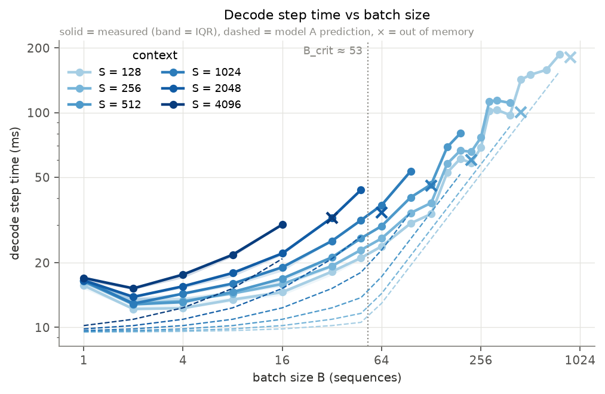
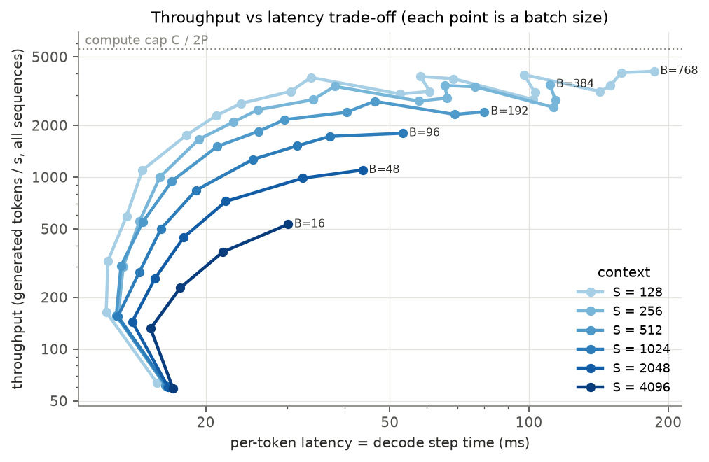
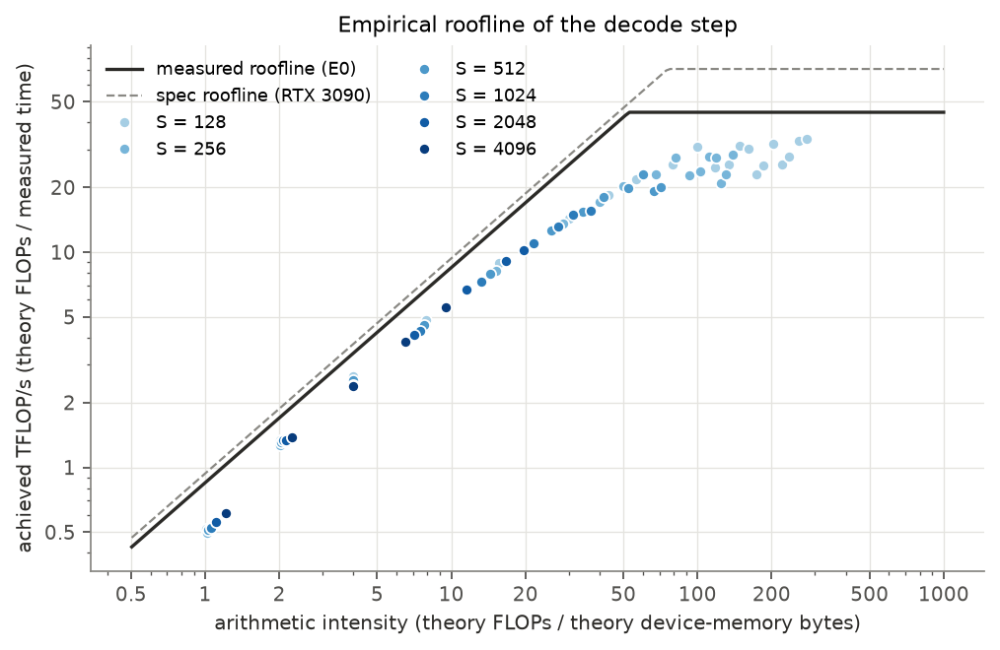
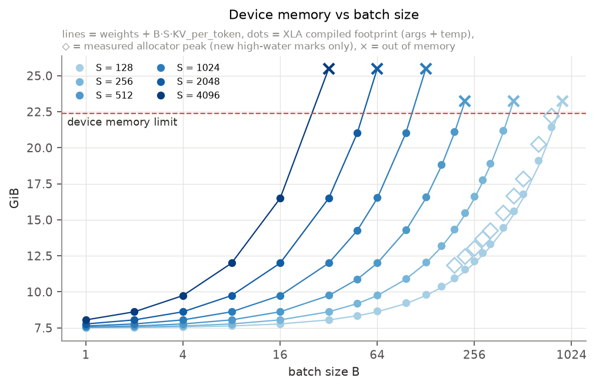
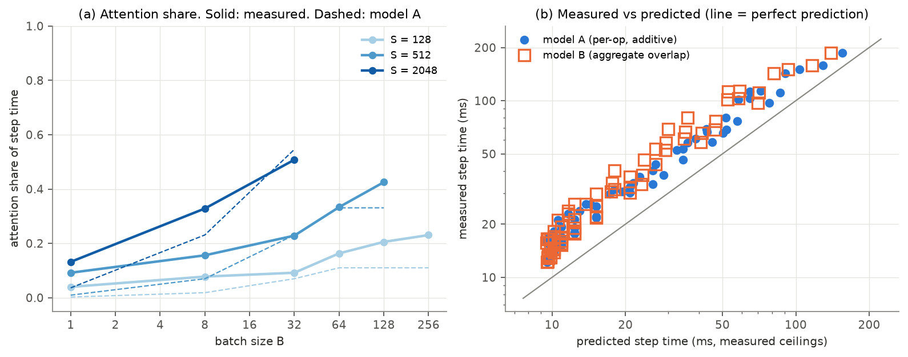
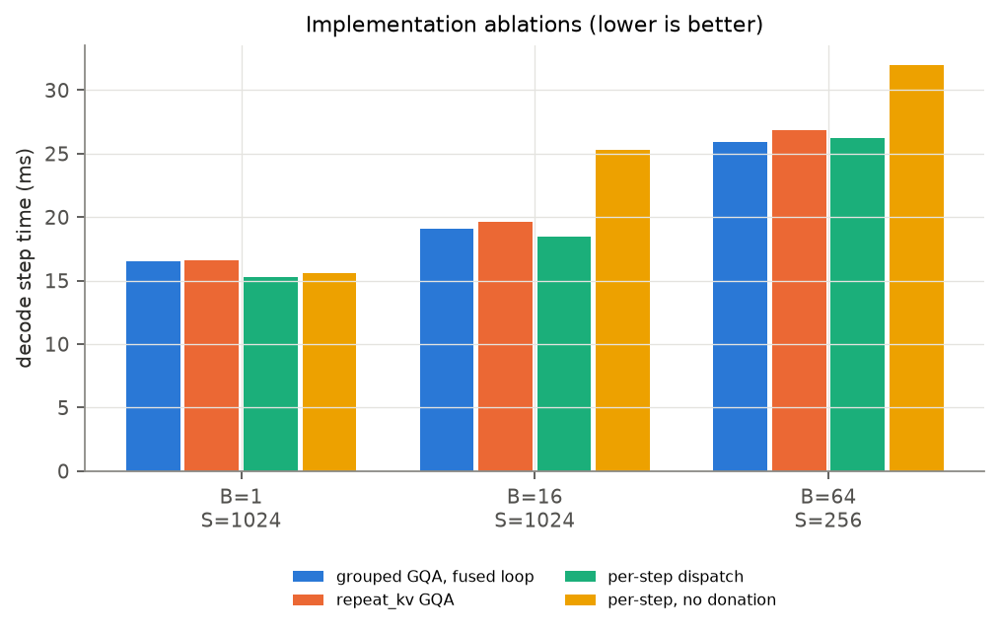

# Batch Scaling of Qwen3-4B Inference on One RTX 3090

**Technical report** · Frank Yang, Amy Zhao · Full run: 2026-11-12

## Summary

We measured how batch size changes latency, throughput and memory when Qwen3-4B generates text on one
NVIDIA RTX 3090. We also measured how context length changes the point where decode stops being
memory-bound. We wrote a minimal JAX forward pass on the Hugging Face weights. It matches Hugging
Face `transformers` to 5.9e-5 in fp32. We timed 71 decode shapes, 18 prefill shapes, 5 end-to-end runs
and 3 ablations.

The main results are:

1. Decode step time stays almost flat from B = 2 to B = 16. It starts to rise between B = 32 and B = 64.
2. Throughput reaches 4,121 tokens/s at B = 768 (S = 128). This is 74% of the measured compute cap.
3. The KV cache fills the card at approximately 98k–115k cached tokens (B·S). The theory gives 108k.
4. For S ≥ 1024, the memory limit stops the batch before the decode step becomes compute-bound.
   Only S ≤ 512 reaches the compute region.
5. Measured step times are 1.2–2.0× the roofline prediction. The per-operation model ("model A") fits
   better than the full-overlap model ("model B").

The administrator limits the GPU to 200 W (the default limit is 350 W). This cap lowers the measured
compute ceiling to 63% of the specification.

---

## 1. Research question

**How does batch size trade off latency, throughput and memory during LLM inference? When does decode
become compute-bound instead of memory-bound? How does context length move that boundary?**

We use these terms in all of the report:

| Term | Meaning |
|---|---|
| B | Batch size: the number of sequences that the GPU processes together |
| S | Context length: the number of cached positions that each sequence attends to |
| T | Prompt length in prefill |
| Decode step | One forward pass that makes one new token for each of the B sequences |
| Step time | Wall-clock time of one decode step (median of 3 × 32 steps) |
| Throughput | B ÷ step time, in generated tokens per second, for all sequences together |
| KV cache | The stored keys and values of all earlier positions |
| Memory-bound | Step time is set by device-memory bandwidth |
| Compute-bound | Step time is set by matrix-multiply speed (FLOP/s) |
| Memory wall | The largest B at a given S that fits in device memory |

## 2. Hypotheses

We wrote these hypotheses before the full run. The numbers come from the RTX 3090
specification sheet.

- **H1 (latency):** Decode step time stays near the 8.6 ms weight-load floor for B ≲ 32 at short S.
  Above B_crit ≈ 76 it increases approximately linearly in B. This region is reachable for S ≲ 1.5k.
- **H2 (throughput):** Throughput increases approximately linearly in B. Then it becomes flat at
  min(compute cap ≈ 8.8k tokens/s, KV cap BW ÷ (S·KV_tok)).
- **H3 (memory wall):** For S ≳ 1.5k, memory runs out before B reaches B_crit. Thus long-context
  decode is memory-bound at all batch sizes that fit. The attention share of step time increases
  with B·S.
- **H4 (memory):** Device memory ≈ 8.04 GB + B·S·144 KiB, plus temporaries (mostly fp32 logits,
  B·V·4 bytes). The measured out-of-memory (OOM) batch agrees with this formula to within a few percent.
- **H5 (prefill):** Prefill with B·T ≳ 76 tokens is compute-bound. A larger prefill batch increases
  latency approximately linearly, with almost no increase in throughput. Time to first token ≈ 2·P·B·T ÷ C.
- **H6 (implementation gap):** Measured times are longer than the ideal. The gap has three causes:
  (i) imperfect overlap of operations, (ii) KV cache copies if the cache buffer is not donated,
  (iii) 4× KV traffic if grouped-query attention (GQA) uses `repeat_kv`. We test (ii) and (iii) directly.

---

## 3. Model architecture

### 3.1 Structure

Qwen3-4B is a decoder-only transformer. The figure below shows the data path for one decode step.
The 36 layers are identical in structure. Each layer has its own weights and its own KV cache.

```
token ids [B, 1]
   │
   ▼
embedding lookup  (V × D = 151,936 × 2,560; the same matrix is the output head)
   │  x : [B, 1, D]
   ▼
┌──────────────────────────── × 36 layers ────────────────────────────┐
│ RMSNorm                                                             │
│   ├─ q = x·Wq → 32 heads × 128 → RMSNorm per head (QK-norm) → RoPE  │
│   ├─ k = x·Wk →  8 heads × 128 → RMSNorm per head (QK-norm) → RoPE  │
│   └─ v = x·Wv →  8 heads × 128                                      │
│ write k, v at position S−1 into this layer's cache [B, 8, S, 128]   │
│ grouped attention: each KV head serves 4 query heads (GQA 4:1)      │
│   scores = q·Kᵀ / √128 → softmax → · V        (reads B·S·K·H·2 values)│
│ x = x + attn·Wo                                                     │
│ RMSNorm                                                             │
│ x = x + Wd·( SiLU(x·Wg) ⊙ (x·Wu) )            (SwiGLU MLP, F = 9,728) │
└─────────────────────────────────────────────────────────────────────┘
   │
   ▼
final RMSNorm → logits = x·Eᵀ  (fp32, [B, V]) → argmax → next token
```

### 3.2 Dimensions and parameters

Source: `Qwen/Qwen3-4B/config.json`. Note that N·H = 4,096 is not equal to D = 2,560.

| Symbol | Meaning | Qwen3-4B | Qwen3-0.6B (smoke test) |
|---|---|---|---|
| L | Layers | 36 | 28 |
| D | Hidden size | 2,560 | 1,024 |
| F | MLP inner size | 9,728 | 3,072 |
| N | Query heads | 32 | 16 |
| K | KV heads | 8 | 8 |
| H | Head size | 128 | 128 |
| N ÷ K | GQA group size | 4 | 2 |
| V | Vocabulary | 151,936 | 151,936 |
| — | Tied input/output embedding | yes | yes |
| — | RoPE θ, RMSNorm ε | 1e6, 1e-6 | 1e6, 1e-6 |

| Component | Parameters per layer | × 36 layers |
|---|---|---|
| Attention: Wq (D × NH), Wk, Wv (D × KH each), Wo (NH × D) | 26.21 M | 943.7 M |
| MLP: Wg, Wu (D × F), Wd (F × D) | 74.71 M | 2,689.6 M |
| Norms (2 × D, plus q_norm and k_norm of H each) | 0.005 M | 0.19 M |
| Embedding / output head (V × D, tied) | — | 389.0 M |
| **Total P** | | **4.022 B** (the loader count agrees exactly) |

### 3.3 What each part costs during inference

| Quantity | Formula | Value |
|---|---|---|
| Weight bytes (bf16) | 2·P | **8.04 GB**, one third of the card |
| KV cache per token | 2 (K and V) · K · H · L · 2 bytes | **147,456 B = 144 KiB** |
| Dense FLOPs per generated token | 2·P | **8.04 GFLOP** |
| Attention FLOPs per token per cached position | 4·N·H·L | **589,824** |

Three facts control the results:

- **Weights are read once per step for all B sequences.** Thus a larger batch shares one weight read.
  The arithmetic intensity of the dense layers is approximately B FLOPs per byte.
- **The KV cache is read once for each sequence.** A larger batch does not share this read. The bytes
  increase as B·S.
- **GQA makes 4 query heads use one KV head.** Thus decode attention does approximately 4 FLOPs for
  each byte of KV cache. This is far below B_crit, so attention is memory-bound at all B.

---

## 4. Theoretical prediction

The theory comes from the inference chapter of the *Scaling Book* (Austin et al.). We use the same
formulas with RTX 3090 values.

### 4.1 Hardware constants

| Constant | Specification | Measured (E0) |
|---|---|---|
| bf16 tensor-core FLOP/s, C | 7.1e13 | **4.47e13** (63%) |
| Device-memory bandwidth, BW | 9.36e11 B/s | **8.48e11 B/s** (91%) |
| B_crit = C ÷ BW | **76** | **53** |
| Usable device memory (`bytes_limit`, 95% of the card) | — | 24,031,264,768 B (22.38 GiB) |

### 4.2 Step-time models

We use two models. The data selects one of them.

```
(A) Per-operation roofline (matmul time and attention time add):
    T_step = B·S·KV_tok / BW  +  max( 2·B·P / C ,  2·P / BW )

(B) Aggregate roofline (all operations overlap perfectly in the fused program):
    T_step = max( B·(2P + 4NHL·S) / C ,  (2P + B·S·KV_tok) / BW )

Throughput = B / T_step   →   upper limit = min( C / 2P ,  BW / (S·KV_tok) )
Memory     = 2P + B·S·KV_tok + temporaries      (temporaries ≈ B·V·4 bytes of fp32 logits)
```

On a GPU, the kernels in one XLA program run mostly one after another. Thus we expected model A to fit
better. Model B is the optimistic limit.

### 4.3 Predicted values (specification constants, model A)

This table was written before the run. Each cell is step time (ms) / throughput (tokens/s).

| S | Max B (95% cap) | B = 1 | B = 16 | B = 64 | B = 128 | B = 256 | B = 512 | KV cap (tokens/s) |
|---|---|---|---|---|---|---|---|---|
| 128 | ~870 | 8.6 / 116 | 8.9 / 1.8k | 9.9 / 6.5k | 17.1 / 7.5k | 34.2 / 7.5k | 68.3 / 7.5k | 50k |
| 256 | ~435 | 8.6 / 116 | 9.2 / 1.7k | 11.2 / 5.7k | 19.7 / 6.5k | 39.3 / 6.5k | OOM | 25k |
| 512 | ~217 | 8.7 / 115 | 9.9 / 1.6k | 13.8 / 4.7k | 24.8 / 5.2k | OOM | OOM | 12k |
| 1024 | ~108 | 8.8 / 114 | 11.2 / 1.4k | 18.9 / 3.4k | OOM | | | 6.2k |
| 2048 | ~54 | 8.9 / 112 | 13.8 / 1.2k | OOM | | | | 3.1k |
| 4096 | ~27 | 9.2 / 108 | 18.9 / 846 | OOM | | | | 1.5k |

Key predicted values:

- Weight-load floor 2P ÷ BW = **8.6 ms** (specification) or **9.5 ms** (measured BW).
- Compute cap C ÷ 2P = **8.8k tokens/s** (specification) or **5.55k tokens/s** (measured C).
- The cache holds at most (bytes_limit − 2P) ÷ KV_tok = **108,416 tokens** (B·S) before temporaries.
- Max B equals B_crit at S = 108,416 ÷ B_crit: **S ≈ 1.4k** (specification; H3 rounds this to
  1.5k) or **S ≈ 2.0k** (measured). This criterion looks only at the dense layers. It does not count
  the KV bytes.

---

## 5. Experimental setup

### 5.1 Hardware and software

| Item | Value |
|---|---|
| GPU | 1 × NVIDIA GeForce RTX 3090, 24 GiB GDDR6X, driver 595.71.05 |
| GPU power limit | **200 W** (set by the server administrator; default 350 W) |
| Host | Shared lab server: AMD EPYC 7402P (24 cores), 62 GB RAM, five RTX 3090 cards |
| Other load on the server | Other users' jobs ran on the other GPUs. Our GPU had no other process. |
| Software | Python 3.12.7, JAX / jaxlib 0.12.0.1 (CUDA 12), safetensors 0.8.0, huggingface_hub 2.4.0; reference only: transformers 5.22.2, torch 2.15.0 (CPU) |
| JAX memory settings | `XLA_PYTHON_CLIENT_PREALLOCATE=true`, `XLA_PYTHON_CLIENT_MEM_FRACTION=0.95` |

### 5.2 Implementation

We did not use a serving engine. A serving engine hides per-step times at a fixed (B, S) and
allocates paged memory in advance. Thus it cannot answer the research question directly.

We wrote the Qwen3 forward pass in approximately 150 lines of JAX
(`notebooks/qwen3_batch_scaling.ipynb`, §5). It uses the Hugging Face weights without change.

- The cache is static, one buffer `[B, K, S, H]` for each layer. The step writes the new position in
  place. The cache buffer is donated, so XLA does not copy it.
- GQA uses grouped einsums. The step does not repeat K and V for each query head.
- The 36 layers are unrolled. (With `lax.scan`, XLA copied each layer's cache slice.)
- `jax.jit` compiles 32 decode steps into one program (`lax.fori_loop`). Thus Python is not in the timed
  region.
- Greedy argmax, synthetic random token ids with a fixed seed, and EOS ignored.

### 5.3 Correctness check (E-check)

We compared our model with Hugging Face `transformers` on the prompt
"The capital of France is Paris. The capital of Japan is".

1. fp32 JAX on the CPU against fp32 Hugging Face on the CPU (all positions).
2. bf16 JAX on the GPU against fp32 Hugging Face.
3. 12 greedy tokens through the KV cache path.

For Qwen3-4B, the check in the notebook needs approximately 40 GB of host RAM. The shared server did not
have this amount free. Thus we ran the same three checks with `check_split.py`. This script computes the
Hugging Face reference in a separate process. Each process ran with a 32 GB memory cap. The check code is the same as in the notebook. On
Qwen3-0.6B, the script gives the same numbers as the notebook.

### 5.4 Measurement protocol

1. Compile each shape once. Record the compile time.
2. Do warm-up steps. Then time 3 repeats of 32 decode steps in one compiled loop.
3. Stop each timed region with `jax.block_until_ready`. Report the median step time and the IQR.
4. Record XLA `memory_analysis()` (argument, output, alias and temporary bytes) and `cost_analysis()`.
5. Record an out-of-memory error as a result. Then skip larger B at the same S.
6. To time decode at context S, allocate a cache of length S and time the step at position S − 1.
   E3 compares this method with real generation.

### 5.5 Experiments

| ID | What | Grid |
|---|---|---|
| E-check | Correctness against Hugging Face | Qwen3-0.6B and Qwen3-4B |
| E0 | Measured ceilings | bf16 matmul 8192³; 2 GiB read and copy |
| E1 | Decode step | B ∈ {1, 2, 4, 8, 16, 32, 48, 64, 96, 128, 160, 192, 224, 256, 288, 320, 384, 448, 512, 640, 768, 896} × S ∈ {128, 256, 512, 1024, 2048, 4096}, until OOM |
| E2 | Prefill | B ∈ {1, 2, 4, 8, 16, 32, 64} × T ∈ {128, 512, 2048} |
| E3 | End-to-end requests | B ∈ {1, 4, 16, 32, 48}; prompt 512 tokens, 256 generated tokens |
| E4 | Attention share | No-attention ablation at 18 points; XLA cost analysis at 5 points; 2 profiler traces |
| E5 | Implementation ablations | `repeat_kv` GQA; per-step dispatch; no buffer donation; at 3 points |

The full run took 40 min (11:44–12:24 local time) after a 4-min smoke test.

---

## 6. Raw results

All data is in `results/full/`. Each table below has a CSV file:

- [`raw/correctness.json`](../results/full/raw/correctness.json)
- [`raw/e0_ceilings.csv`](../results/full/raw/e0_ceilings.csv)
- [`raw/e1_decode.csv`](../results/full/raw/e1_decode.csv)
- [`summary_decode.csv`](../results/full/summary_decode.csv)
- [`raw/e2_prefill.csv`](../results/full/raw/e2_prefill.csv)
- [`raw/e3_e2e.csv`](../results/full/raw/e3_e2e.csv)
- [`raw/e4_attn_share.csv`](../results/full/raw/e4_attn_share.csv)
- [`raw/e4_cost.csv`](../results/full/raw/e4_cost.csv)
- `raw/e5_*.csv`

The executed notebook is [`executed_full.ipynb`](../results/full/executed_full.ipynb).

### 6.1 E-check: correctness

| Check | Qwen3-4B | Qwen3-0.6B |
|---|---|---|
| fp32 JAX vs fp32 HF, max \|Δlogit\| (limit 5e-3) | **5.9e-5** | 6.0e-5 |
| fp32 top-1 agreement | 100% | 100% |
| bf16 (GPU) vs fp32 HF, max \|Δlogit\| | 0.33 | 0.19 |
| bf16 top-1 agreement | 11 of 12 positions | 12 of 12 |
| First generated token equals HF | yes | yes |
| Greedy text | "…Japan is Tokyo. The capital of Germany is Berlin. The capital of" | "…Japan is Tokyo. The capital of Italy is Rome. The capital of" |

The standard deviation of the reference logits is 3.8. Thus the bf16 error is small relative to the logits.

### 6.2 E0: measured ceilings

| Measurement | Value | Fraction of specification |
|---|---|---|
| bf16 matmul (8192 × 8192 × 8192) | 44.7 TFLOP/s | 63% |
| Device-memory read (2 GiB) | 848 GB/s | 91% |
| Device-memory copy (2 GiB) | 819 GB/s | 87% |

### 6.3 E1: decode step time (ms, median)

"—" means the shape did not fit in memory. The first shape that did not fit at each S is in §6.6.

| B \ S | 128 | 256 | 512 | 1024 | 2048 | 4096 |
|---|---|---|---|---|---|---|
| 1 | 15.7 | 16.5 | 16.4 | 16.5 | 16.6 | 17.0 |
| 2 | 12.2 | 12.9 | 12.8 | 12.9 | 13.9 | 15.2 |
| 4 | 12.3 | 13.3 | 13.1 | 14.4 | 15.5 | 17.6 |
| 8 | 13.5 | 14.4 | 14.6 | 16.0 | 17.9 | 21.8 |
| 16 | 14.6 | 15.9 | 16.9 | 19.1 | 22.1 | 30.1 |
| 32 | 18.2 | 19.3 | 21.2 | 25.3 | 32.4 | — |
| 48 | 21.1 | 23.0 | 26.0 | 31.6 | 43.7 | — |
| 64 | 23.9 | 26.0 | 29.6 | 37.1 | — | — |
| 96 | 30.5 | 34.1 | 40.3 | 53.4 | — | — |
| 128 | 33.8 | 38.0 | 46.4 | — | — | — |
| 160 | 52.6 | 57.8 | 69.1 | — | — | — |
| 192 | 61.0 | 66.6 | 80.1 | — | — | — |
| 224 | 58.3 | 65.8 | — | — | — | — |
| 256 | 68.7 | 76.5 | — | — | — | — |
| 288 | 102.0 | 113.0 | — | — | — | — |
| 320 | 103.0 | 114.0 | — | — | — | — |
| 384 | 97.5 | 111.0 | — | — | — | — |
| 448 | 142.4 | — | — | — | — | — |
| 512 | 150.1 | — | — | — | — | — |
| 640 | 158.3 | — | — | — | — | — |
| 768 | 186.4 | — | — | — | — | — |

The variation between repeats is small. The median relative IQR is 0.7%. The largest is 7.9% (B = 2, S = 512).

### 6.4 E1: decode throughput (generated tokens/s, all sequences)

| B \ S | 128 | 256 | 512 | 1024 | 2048 | 4096 |
|---|---|---|---|---|---|---|
| 1 | 64 | 61 | 61 | 60 | 60 | 59 |
| 4 | 325 | 302 | 305 | 279 | 257 | 227 |
| 16 | 1,097 | 1,004 | 947 | 839 | 723 | **531** |
| 32 | 1,759 | 1,656 | 1,510 | 1,266 | 986 | — |
| 48 | 2,278 | 2,091 | 1,846 | 1,521 | **1,099** | — |
| 64 | 2,683 | 2,466 | 2,159 | 1,726 | — | — |
| 96 | 3,146 | 2,816 | 2,382 | **1,799** | — | — |
| 128 | 3,792 | 3,367 | 2,761 | — | — | — |
| 192 | 3,148 | 2,884 | **2,397** | — | — | — |
| 256 | 3,729 | 3,345 | — | — | — | — |
| 384 | 3,938 | **3,459** | — | — | — | — |
| 768 | **4,121** | — | — | — | — | — |

Bold = the largest B that fits at that S. The complete table is in `summary_decode.csv`.

### 6.5 E1: measured time ÷ predicted time (measured ceilings)

| Model | Median | Range | Spread (s.d. of log ratio) |
|---|---|---|---|
| A (per-operation) | 1.55 | 1.20–2.00 | 0.121 |
| B (full overlap) | 1.63 | 1.28–2.31 | 0.153 |

### 6.6 E1: memory

| S | Largest B that fits | Cached tokens (B·S) | First B that did not fit | Cached tokens |
|---|---|---|---|---|
| 128 | 768 | 98,304 | 896 | 114,688 |
| 256 | 384 | 98,304 | 448 | 114,688 |
| 512 | 192 | 98,304 | 224 | 114,688 |
| 1024 | 96 | 98,304 | 128 | 131,072 |
| 2048 | 48 | 98,304 | 64 | 131,072 |
| 4096 | 16 | 65,536 | 32 | 131,072 |

- **Accounting:** in all 71 shapes that fit, the XLA argument bytes and the allocated bytes were equal
  to 2P + B·S·KV_tok, to within 3.1 KB.
- **Donation:** XLA aliased (donated) 100% of the KV cache bytes in all shapes.
- **Temporaries:** temporary bytes increase linearly with B. At B = 768, XLA used 475 MB of temporaries.
  The fp32 logits are B·V·4 = 467 MB.

### 6.7 E2: prefill

| B | T | Time (ms) | Predicted 2PBT/C (ms) | Ratio | Achieved TFLOP/s | Tokens/s |
|---|---|---|---|---|---|---|
| 1 | 128 | 33 | 21 | 1.58 | 28.3 | 3,849 |
| 4 | 128 | 98 | 84 | 1.16 | 38.5 | 5,237 |
| 16 | 128 | 315 | 337 | 0.93 | 47.8 | 6,507 |
| 64 | 128 | 1,299 | 1,348 | 0.96 | 46.4 | 6,308 |
| 1 | 512 | 108 | 87 | 1.25 | 35.7 | 4,722 |
| 4 | 512 | 346 | 347 | 1.00 | 44.8 | 5,914 |
| 16 | 512 | 1,479 | 1,388 | 1.07 | 41.9 | 5,540 |
| 64 | 512 | 6,230 | 5,554 | 1.12 | 39.8 | 5,260 |
| 1 | 2048 | 528 | 389 | 1.36 | 32.9 | 3,876 |
| 4 | 2048 | 2,179 | 1,554 | 1.40 | 31.9 | 3,759 |
| 8 | 2048 | 4,439 | 3,109 | 1.43 | 31.3 | 3,691 |
| 16 | 2048 | OOM | | | | |

The prediction uses the theory FLOPs, including attention. All 18 rows that fit are in
`raw/e2_prefill.csv`.

### 6.8 E3: end-to-end requests (prompt 512 tokens, 256 generated tokens)

| B | Time to first token (ms) | Decode ms/step | Request latency (s) | Decode tokens/s | End-to-end tokens/s |
|---|---|---|---|---|---|
| 1 | 124 | 16.3 | 4.31 | 61 | 59 |
| 4 | 385 | 14.7 | 4.16 | 271 | 246 |
| 16 | 1,567 | 18.9 | 6.40 | 848 | 640 |
| 32 | 3,139 | 25.5 | 9.66 | 1,257 | 848 |
| 48 | 5,052 | 32.6 | 13.39 | 1,474 | 918 |

### 6.9 E4: attention share of step time

Attention share = 1 − (step time without attention ÷ step time with attention). The model-A share uses
the measured ceilings.

| B | S | With attention (ms) | Without (ms) | Measured share | Model A share |
|---|---|---|---|---|---|
| 1 | 128 | 15.7 | 15.1 | 4% | 0.2% |
| 32 | 128 | 18.2 | 16.5 | 9% | 7% |
| 128 | 128 | 33.8 | 26.8 | 21% | 11% |
| 256 | 128 | 68.7 | 52.8 | 23% | 11% |
| 1 | 512 | 16.4 | 14.9 | 9% | 1% |
| 32 | 512 | 21.2 | 16.4 | 23% | 23% |
| 64 | 512 | 29.6 | 19.8 | 33% | 33% |
| 128 | 512 | 46.4 | 26.6 | 43% | 33% |
| 1 | 2048 | 16.6 | 14.4 | 13% | 4% |
| 8 | 2048 | 17.9 | 12.0 | 33% | 23% |
| 32 | 2048 | 32.4 | 16.0 | 51% | 55% |

XLA `cost_analysis()` compared with theory:

| B | S | Theory GFLOP | XLA GFLOP | Theory GB | XLA GB |
|---|---|---|---|---|---|
| 1 | 128 | 8.1 | 8.7 | 8.1 | 9.6 |
| 64 | 128 | 519.7 | 470.6 | 9.3 | 13.5 |
| 256 | 128 | 2,078.7 | 1,881.9 | 12.9 | 26.5 |
| 16 | 1024 | 138.4 | 138.8 | 10.5 | 16.9 |
| 8 | 4096 | 83.7 | 84.2 | 12.9 | 24.2 |

### 6.10 E5: implementation ablations (step time, ms)

| B | S | Baseline: grouped GQA, fused loop, donated cache | `repeat_kv` GQA | Per-step dispatch, donated | Per-step dispatch, cache copied |
|---|---|---|---|---|---|
| 1 | 1024 | 16.5 | 16.6 (+0%) | 15.3 (−8%) | 15.6 |
| 16 | 1024 | 19.1 | 19.6 (+3%) | 18.5 (−3%) | 25.3 (+6.9 ms vs donated) |
| 64 | 256 | 26.0 | 26.8 (+3%) | 26.2 (+1%) | 32.0 (+5.7 ms vs donated) |

---

## 7. Figures

All six figures come from §15 of the notebook. They are in `results/full/figures/`.

### Figure 1. Decode step time against batch size



Solid lines are measurements. Dashed lines are the model-A prediction. × marks the first B that did
not fit. The dotted line is the measured B_crit ≈ 53. Step time is flat from B = 2 to B = 16. Then it
increases. All measured lines are above the prediction.

### Figure 2. Throughput against latency



Each point is one batch size. At S = 128, throughput increases 6.7× from B = 2 to B = 16, but the
step time increases only 1.2×. Then the curves become flat below the compute cap. Long contexts stop
at the memory wall at a much lower throughput.

### Figure 3. Empirical roofline of the decode step



The x-axis is arithmetic intensity: theory FLOPs ÷ theory bytes. The y-axis is achieved FLOP/s. The
points follow the bandwidth slope at approximately 60% of the measured roofline. Only S ≤ 512
reaches the compute region (intensity > 53). The maximum intensity is 36.8 at S = 1024, 19.7 at
S = 2048 and 9.5 at S = 4096.

### Figure 4. Device memory against batch size



Lines are 2P + B·S·KV_tok. Dots are the XLA compiled footprint. The red line is `bytes_limit`. The
dots are on the lines. Each × is above the limit, as the formula predicts.

### Figure 5. Attention share and model fit



(a) The measured attention share increases with B and with S. Model A agrees in the middle range. At
small B and at large B with short S, model A gives a share that is too low. (b) Model A (dots) is
closer to the diagonal and has a smaller spread than model B (squares). Both under-predict by
approximately 1.5×.

### Figure 6. Implementation ablations



A cache copy (no donation) adds 5.7–6.9 ms at 16k cached tokens. `repeat_kv` and per-step dispatch
change the step time by only a small amount.

---

## 8. Interpretation

### 8.1 Hypotheses

| Hypothesis | Result | Evidence |
|---|---|---|
| H1 latency | **Partly confirmed** | Flat region and linear increase are present. The floor is 12–17 ms, not 8.6 ms. The increase starts near B ≈ 32–64, not 76. |
| H2 throughput | **Partly confirmed** | Linear to B ≈ 16, then flat. The peak is 4,121 tokens/s, 47% of the specification cap and 74% of the measured cap. |
| H3 memory wall | **Confirmed** | With the dense-layer criterion, the memory wall is before B_crit for S ≥ 2048. With the KV bytes included, the whole step is memory-bound at every batch that fits for S ≥ 1024. |
| H4 memory | **Confirmed** | Exact byte accounting. All 6 OOM boundaries agree with the formula. |
| H5 prefill | **Confirmed** | Prefill reaches 28–48 TFLOP/s. A larger batch increases latency linearly and throughput by at most 1.7×. |
| H6 gap | **Partly confirmed** | (ii) cache copy: confirmed exactly. (iii) `repeat_kv`: rejected. (i) A 1.2–2.0× gap remains without a full explanation. |

### 8.2 H1: latency

For B = 2 to 16 at S ≤ 512, the step time increases only from 12.2 ms to 16.9 ms. The GPU reads the
8.04 GB of weights in each step. More sequences share this read, so the cost per sequence decreases.

Above B ≈ 64, the step time increases approximately linearly with B. At S = 128, it is ×2.03 from
B = 128 to 256, and ×1.91 from B = 384 to 768. The increase starts before the specification B_crit
of 76, because the measured B_crit is 53. The 200 W power limit probably causes this. A power limit
lowers the compute ceiling (63% of specification) more than the bandwidth (91%). Thus B_crit decreases.

The floor is 12.2 ms. The weight-read time at the measured bandwidth is 9.5 ms. Thus approximately
2.7 ms per step (22%) is overhead that the roofline does not include. §8.7 discusses B = 1.

### 8.3 H2: throughput

From B = 1 to B = 16 at S = 128, throughput increases 17× (64 → 1,097 tokens/s). This is almost
linear. From B = 128 to B = 768, it increases only from 3,792 to 4,121 tokens/s. The highest point,
4,121 tokens/s, is 33.5 TFLOP/s of dense work. This is 75% of the measured matmul ceiling.

The specification cap of 8.8k tokens/s is not reachable on this card at 200 W.

At long contexts, the memory wall stops throughput before the KV-bandwidth cap. At S = 4096, the
maximum is 531 tokens/s at B = 16. The KV cap is 1,404 tokens/s.

### 8.4 H3: the memory wall and context length

The cache holds approximately 98k–115k tokens (B·S) on this card. Thus the largest B is approximately
inversely proportional to S. We use two criteria to find the crossover.

1. **Dense-layer criterion (the H3 statement).** The largest B equals the measured B_crit (53) at
   S ≈ 108,416 ÷ 53 ≈ 2,050. For S ≥ 2048 the largest B (48, 16) is below B_crit. For S ≤ 1024 it is
   above B_crit (96 at S = 1024). The predicted crossover was S ≈ 1.4–1.5k. It moved to S ≈ 2k because
   the measured B_crit (53) is lower than the specification value (76). The memory limit did not change.
2. **Whole-step criterion (KV bytes included).** The KV reads add bytes but almost no FLOPs. Thus the
   intensity of the whole step is lower than B. In Figure 3, only S ≤ 512 has points above
   intensity 53. The maximum is 36.8 at S = 1024, 19.7 at S = 2048 and 9.5 at S = 4096. Thus for
   **S ≥ 1024, every batch that fits is memory-bound.**

A larger batch still increases throughput at long context. But no batch reaches the compute region.

The attention share increases with B·S, from 4% (B = 1, S = 128) to 51% (B = 32, S = 2048). At long
context, attention (KV reads) is the largest part of the step. A larger batch cannot share these reads.

### 8.5 H4: memory

The memory model is exact for the static part. In all 71 shapes, XLA arguments = 2P + B·S·KV_tok, to
within 3.1 KB. The temporaries agree with the fp32-logit estimate (475 MB measured, 467 MB predicted,
at B = 768). All six OOM boundaries are between the last fitting grid point and the first failing grid
point. The theory boundary is 108k tokens, minus approximately 3k tokens for temporaries at large B.
For S ≤ 512 the grid step at the boundary is 17%, so the test shows agreement within ±8%. For S ≥ 1024
the grid step is 33–100%, so the test is much weaker there.

### 8.6 H5: prefill

Prefill is compute-bound at all tested sizes. One sequence of 128 tokens already gives 28 TFLOP/s. With
B·T ≥ 512, prefill gives 31–48 TFLOP/s. Some points are faster than the E0 matmul ceiling (47.8 against
44.7 TFLOP/s). Thus E0, which uses one matrix size, measures a ceiling slightly lower than the true value.

A larger prefill batch increases latency approximately linearly. At T = 512, time to first token
increases 57× from B = 1 to B = 64, for a throughput gain of only 1.1×. In E3, time to first token is
124 ms at B = 1 and 5.05 s at B = 48.

At T = 2048, prefill takes 1.4× the dense-FLOP prediction. The fp32 attention scores (B·N·T²·4 bytes
per layer) are large at this length. These temporaries also cause the OOM at B = 16, T = 2048. The
weights and cache need only 12.9 GB. But the temporaries for B = 8 are already 6.6 GB.

### 8.7 H6: the implementation gap

- **(ii) Cache copy: confirmed.** Without donation, XLA copies the cache in each step. The extra time
  agrees with a read and a write of the cache at the measured bandwidth. At B·S = 16,384 tokens (2.42 GB
  cache), the prediction is 5.7 ms. We measured 5.7 ms (B = 64, S = 256) and 6.9 ms (B = 16, S = 1024).
  At 1,024 tokens, the prediction is 0.36 ms and we measured 0.34 ms.
- **(iii) `repeat_kv`: rejected.** Repeated K and V cost only 0–3% more. We predicted up to 4× KV
  traffic. XLA probably fuses the repeat into the attention einsum, so it does not write the repeated
  tensor to memory. We did not examine the compiled program to confirm this.
- **Per-step dispatch** costs at most 1%. At B = 1 it is 8% faster than the fused loop. Thus Python
  dispatch is not part of the gap.
- **(i) Remaining gap.** The measured time is 1.20–2.00× the model-A prediction. The ablations do not
  explain this gap. Possible causes are:
  - gaps between the many kernels of a 36-layer step;
  - many small operations (norms, RoPE, softmax) that do not reach full bandwidth;
  - the 200 W power limit, which can lower the clock under load.

  We saved profiler traces for (B, S) = (1, 1024) and (64, 256), but we did not analyze them.

### 8.8 Which step-time model fits

Model A fits better. Its ratios have a smaller spread (0.12 against 0.15) and a smaller maximum (2.00
against 2.31). Model B assumes that compute and memory traffic overlap fully. This overlap does not
occur. Neither model predicts absolute times. Both are low by approximately 1.5×. A model-A prediction
multiplied by 1.55 predicts all 71 decode shapes to within approximately ±30%.

### 8.9 Other findings

- **B = 1 is slower than B = 2** at every S (15.7 against 12.2 ms at S = 128). The same effect occurs
  without attention (15.1 against 12.4 ms at B = 8). Thus the cause is in the dense layers. XLA
  probably selects a matrix-vector kernel for B = 1 that is slower than the matrix-matrix kernel.
- **Batch sizes that are multiples of 128 are more efficient.** At S = 128, B = 160 takes 52.6 ms but
  B = 128 takes 33.8 ms (+56% time for +25% sequences). Also, B = 384 (97.5 ms) is faster than B = 288
  (102.0 ms). The matmul tiles probably have a width of 128, so other sizes waste part of a tile.
- **XLA autotuning failed near the memory wall.** When the cache fills the card, the autotuner cannot
  get memory to test kernels. It then uses a default kernel. Thus the largest-B points can be slower
  than necessary.
- **XLA `cost_analysis()` bytes are not real traffic.** At (B, S) = (8, 4096), XLA reports 24.2 GB per
  step. At 848 GB/s, this needs 28.6 ms, but the step took 21.8 ms. The probable cause is that XLA counts
  the in-place cache update as a read and write of the full cache. The XLA FLOP count is within 10% of
  theory.
- **Real generation is 8–19% slower than the fixed-S method predicts.** In E3 the context increases
  from 512 to 768, so the mean context is approximately 640. We interpolated E1 linearly to S = 640.
  At B = 16, 32 and 48, the E3 step times (18.9, 25.5 and 32.6 ms) are 8%, 15% and 19% above this
  value. At B = 1 the difference is 0%. Thus E1 under-estimates real decode time at large B. We did not
  find the cause. The E3 cache length is 768, so each step reads 768 cache positions, not 640. This can
  explain part of the difference.

### 8.10 Answer to the research question

On one RTX 3090 with Qwen3-4B:

- **Up to B ≈ 16**, a larger batch gives approximately free throughput. Latency increases by less than
  20%.
- **From B ≈ 32 to 64**, the dense layers start to become compute-bound. Each additional sequence then
  adds step time.
- **Above B ≈ 128**, throughput is approximately constant at 3.4k–4.1k tokens/s. Latency increases
  linearly.
- **Memory sets a hard limit of approximately 100k cached tokens.** For contexts of 1k tokens and
  longer, this limit arrives before the step becomes compute-bound. Thus long-context decode stays
  memory-bound. The best throughput at S = 4096 is 531 tokens/s.

---

## 9. Limitations

1. **One card, one run.** Each point has 3 repeats of 32 steps. The IQR is small, but we did not repeat
   the run on a different day or on a different card.
2. **Power and clocks.** The GPU had a 200 W limit. We did not record clocks, temperature or power
   during the run. Other users' jobs ran on the other four GPUs of the same server. They share the host
   CPU, PCIe, power supply and cooling.
3. **E0 measures one matrix size.** Prefill exceeded the E0 ceiling. Thus the measured C and B_crit
   are approximate.
4. **Coarse grid at the memory wall.** At the OOM boundary, the B step is 17% for S ≤ 512 and 33–100%
   for S ≥ 1024. Thus the OOM test has a resolution of approximately ±8% only for S ≤ 512.
5. **Autotuning near OOM.** Some kernels at the largest B were not autotuned. These points can be
   slower than a tuned program.
6. **Peak-memory data.** The autotuner filled the allocator pool. Thus `peak_bytes_in_use` is useful in
   only 10 of 71 rows. We use the XLA footprint instead.
7. **Not a production server.** Our implementation has no paged attention, continuous batching, fused
   attention kernels (for example FlashAttention), CUDA graphs or quantization. A serving engine can
   give different absolute numbers. The trends should be the same.
8. **Synthetic workload.** Random token ids, greedy decode, EOS ignored, and one fixed S for each timed
   step. E3 checks the fixed-S method only for S between 512 and 768. There, real generation was
   8–19% slower than E1 at B ≥ 16.
9. **bf16 only.** We did not test int8, fp8 or 4-bit weights. These would change the weight bytes, the
   floor and B_crit.
10. **Correctness check outside the notebook.** We ran the Qwen3-4B check with `check_split.py`
    because of host RAM. The executed notebook shows the check as skipped.
11. **Unexplained gap.** We did not analyze the profiler traces. Thus the 1.2–2.0× gap and the B = 1
    effect have no proven cause.

---

## 10. Reproduction

### 10.1 Set up the environment

1. Get a Linux server with one free RTX 3090 and at least 32 GB of free host RAM.
2. Make sure that no other process uses the GPU:

   ```bash
   nvidia-smi
   ```

3. Clone the repository. Then create the environment:

   ```bash
   uv venv .venv --python 3.12 && source .venv/bin/activate
   ```

   ```bash
   uv pip install -r requirements-local.txt && uv pip install torch==2.15.0 --index-url https://download.pytorch.org/whl/cpu
   ```

4. Make sure that JAX finds the GPU. The output must show a `CudaDevice`:

   ```bash
   python -c "import jax; print(jax.devices())"
   ```

5. Record the GPU power limit. Our run used 200 W:

   ```bash
   nvidia-smi --query-gpu=index,power.limit,power.default_limit --format=csv
   ```

### 10.2 Run the experiments

The script `run_experiments.sh` runs the smoke test and then the full run on the same GPU.

1. Start a tmux session:

   ```bash
   tmux new -s qwen3
   ```

2. Start the script. Set `GPU` to the index of the free GPU (`0` in this example):

   ```bash
   GPU=0 bash run_experiments.sh 2>&1 | tee -a results/driver.log
   ```

3. Detach with `Ctrl-b d`. Monitor the progress:

   ```bash
   tail -n 3 results/full/raw/*.jsonl
   ```

The full run takes approximately 40 minutes. Each experiment writes rows as it finishes them. If the run
stops, start the same command again. The run then continues from the last row.

### 10.3 Run the Qwen3-4B correctness check

Do this step if the full run skipped the check because of host RAM. Each of the two commands ran in
less than 32 GB of host RAM in our run. Set `CUDA_VISIBLE_DEVICES` to the index of the free GPU.

```bash
source .venv/bin/activate && export NB=$PWD/notebooks/qwen3_batch_scaling.py RUN_MODE=full OUT_DIR=/tmp/check_full CUDA_VISIBLE_DEVICES=0 XLA_PYTHON_CLIENT_MEM_FRACTION=0.5
```

```bash
python check_split.py ref /tmp/ref_full.npz && python check_split.py jax /tmp/ref_full.npz
```

```bash
cp /tmp/check_full/raw/correctness.json results/full/raw/correctness.json
```

The script prints `E-check PASSED` if the check passes.

### 10.4 Make the figures again

Open the notebook with `OUT_DIR` set to `results/full`. Run only §1–4 and §15. §15 reads only the
saved results, so it does not need a GPU.

---

## References

- J. Austin et al., *How to Scale Your Model*, chapter "All About Transformer Inference".
  https://jax-ml.github.io/scaling-book/inference/
- Qwen Team, *Qwen3-4B* model card and `config.json`. https://huggingface.co/Qwen/Qwen3-4B
- NVIDIA, *NVIDIA Ampere GA102 GPU Architecture* whitepaper (RTX 3090 specifications).
- JAX documentation, *GPU memory allocation*. https://docs.jax.dev/en/latest/gpu_memory_allocation.html
- ASD-STE100, *Simplified Technical English*, Issue 9 (writing style of this report).
